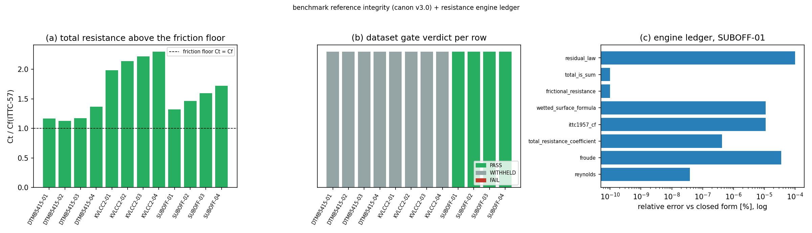

# 对标参考库一致性审计 + 阻力引擎解析账本

> 产物：`backend/services/benchmark_integrity.py`（一致性闸门）、
> `backend/services/benchmark_dataset_audit.py`（消费侧 facade）、
> `scripts/benchmark_audit.py`（账本生成器）、`runs/m1614/benchmark_audit.json`（本页全部数字的来源）、
> `backend/tests/test_benchmark_integrity.py` + `backend/tests/test_benchmark_audit_endpoint.py`（pytest）。
> 本页数值由 `scripts/gen_benchmark_doc.py` 从该 JSON 注入，无手抄。
> **数据集判定以正典 v3.0 为准**（`backend/data/benchmark_reference.json` v3.0、
> `services/benchmark_canon.py`）；本页是同一批数据的独立复核，二者不一致时以正典为准。

## 1. 案例介绍（物理背景与对象）

平台唯一的实验参考库 `backend/data/benchmark_reference.json` 支撑
`/api/v1/calculations/benchmark_validate` 的全部对标结论（12 行算例、3 型船：SUBOFF 轴对体、
DTMB-5415 水面舰、KVLCC2 油轮），也是历次「模型对 SUBOFF 误差 >300% → honest-FAIL」判词的唯一依据。
参考行本身必须先满足它所引用的定义：

- 总阻力系数 `C_T = R_T / (0.5·ρ·S·V²)`
- 傅汝德数 `Fn = V / sqrt(g·L)`
- 方形系数几何恒等式 `Δ = ρ·L·B·T·Cb`

任一行违反上述任一恒等式，坏掉的是**参考值**而不是数值模型；据此算出的误差百分比不构成验证结论。
SUB OFF 模型试验介质为淡水（Roddy 1990 拖曳水池），正典 v3.0 因此把该型 4 行钉在 ρ=998.2 kg/m³。

## 2. 怎么做的（方法/工具链）

1. `services/benchmark_integrity.py`：纯函数闸门（仅 stdlib，可脱离 DB/API 测试）。逐行校验
   `froude_closure`（默认 2%）、`displacement_closure`、`resistance_closure`（默认 1%，
   相对它所支撑的 15% 精度判决）、`friction_floor`、`form_bands`；行级 verdict 取最差项
   （PASS < WARN < WITHHELD < FAIL）。物性优先取行内 `reference_density_kg_m3`（正典溯源字段）。
2. `api/domain/ship_benchmark.py` 接线：物理核**进程内**调用（`services/ship_resistance`），
   HTTP 跳仅在 `SHIP_BENCHMARK_REMOTE=1` 时启用且带 `speed_ms` 回声校验 + 多端口探测；
   结果携带 `dataset_status`/`withheld`/`calc_rt_n`；新增 `GET /calculations/benchmark_audit` 账本端点；
   端点响应同时透出 `total_resistance_coefficient` 与 `method`。
3. 阻力引擎解析账本：对阻力端点返回逐项用闭式解复算（Re、Fn、ITTC-1957 摩擦线、湿表面积、
   R_f、R_t = R_f + R_r、残阻律、C_T 恒等式）。引擎探测器本次运行的传输方式：
   **in_process_fallback**。

## 3. 计算结果（数字表）

### 3.1 参考库逐行判定（正典 v3.0：PASS=4 · WITHHELD=8 ·
WARN=0 · FAIL=0；数据集级 `binding=True`）

| case | verdict | Fn 偏差 | C_T↔R_T 闭合 | C_t/C_f |
|---|---|---|---|---|
| DTMB5415-01 | WITHHELD | 0.01% | 缺少 Ct 或 Rt 或 V，无法闭合 | 1.17 |
| DTMB5415-02 | WITHHELD | 0.00% | 缺少 Ct 或 Rt 或 V，无法闭合 | 1.127 |
| DTMB5415-03 | WITHHELD | 0.00% | 缺少 Ct 或 Rt 或 V，无法闭合 | 1.175 |
| DTMB5415-04 | WITHHELD | 0.00% | 缺少 Ct 或 Rt 或 V，无法闭合 | 1.367 |
| KVLCC2-01 | WITHHELD | 0.03% | 缺少 Ct 或 Rt 或 V，无法闭合 | 1.983 |
| KVLCC2-02 | WITHHELD | 0.02% | 缺少 Ct 或 Rt 或 V，无法闭合 | 2.142 |
| KVLCC2-03 | WITHHELD | 0.01% | 缺少 Ct 或 Rt 或 V，无法闭合 | 2.222 |
| KVLCC2-04 | WITHHELD | 0.00% | 缺少 Ct 或 Rt 或 V，无法闭合 | 2.302 |
| SUBOFF-01 | PASS | 0.01% | Ct·½ρV²S = 92.52 N vs Rt = 92.52 N (误差 0.0%) | 1.325 |
| SUBOFF-02 | PASS | 0.00% | Ct·½ρV²S = 173.13 N vs Rt = 173.13 N (误差 0.0%) | 1.464 |
| SUBOFF-03 | PASS | 0.00% | Ct·½ρV²S = 284.04 N vs Rt = 284.04 N (误差 0.0%) | 1.595 |
| SUBOFF-04 | PASS | 0.01% | Ct·½ρV²S = 428.49 N vs Rt = 428.49 N (误差 0.0%) | 1.721 |

- SUBOFF 4 行判 PASS：C_T 与 R_T 两列在淡水 998.2 kg/m³ 下闭合到 0.01%，S=5.42 m² 为记录自带实测值。
- DTMB-5415 / KVLCC2 各 4 行判 WITHHELD：记录未给实测湿面积，`resistance_closure` 无法运行
  （不是"矛盾"，而是"不可复核"）；按规则不得据此授予任何精度判决。

### 3.2 阻力引擎解析账本（探针 SUBOFF-01，V = 3.0 m/s，
L = 4.356 m，传输 = in_process_fallback）

| 校验项 | 引擎输出 | 闭式解 | 误差 | <3% |
|---|---|---|---|---|
| reynolds | 13015936.25 | 13015936.25 | 3.826e-10 | ✅ <3% |
| froude | 0.458926 | 0.458926 | 3.513e-07 | ✅ <3% |
| total_resistance_coefficient | 0.00346189 | 0.00346189 | 4.282e-09 | ✅ <3% |
| ittc1957_cf | 0.00286721 | 0.00286721 | 1.104e-07 | ✅ <3% |
| wetted_surface_formula | 4.417911 | 4.417911 | 1.112e-07 | ✅ <3% |
| frictional_resistance | 56.8878 | 56.8878 | 0.000e+00 | ✅ <3% |
| total_is_sum | 68.6868 | 68.6868 | 0.000e+00 | ✅ <3% |
| residual_law | 0.00059468 | 0.00059468 | 1.000e-06 | ✅ <3% |

### 3.3 对标链路的历史缺陷（实测，非推测）

- 旧载荷键 `speed`：引擎按 **1.0 m/s**（端点默认值）计算，而请求为
  3.0 m/s —— 静默偏低 3.0 倍且不报错（`silently_wrong=True`）。
- 旧代码读 `calc_data["ct"]`，而端点只回 `total_resistance_n` → `calc_ct` 恒 0 → 每行误差恒 100%、恒 FAIL。
- 旧代码只连 :8002（多数部署已不监听）→ 每行降级 `Resistance API call failed`（error_pct = 999）。
- 参考库的**跨库口径**曾把模型试验行按海水 1025 kg/m³ 反算，使 SUBOFF 的 R_T 由 92.52 N 虚高到
  95.0 N（+2.68%），另有 v1 的 12.5 N（反解湿面积 0.71 m²，与实测 5.42 m² 差 7.6 倍）——两者都已
  作为 `legacy_values` 留在正典里，可复核。

## 4. 结果图

(a) 每行 `C_t/C_f(ITTC-57)`：全部 >1（总阻力不低于摩擦下限），最低约 1.1；(b) 逐行闸门判定色块
（绿 PASS / 灰 WITHHELD）；(c) 引擎账本各项相对误差（对数轴），全部 ≈1e-9~1e-6 量级。

## 5. 注意点（踩过的坑与适用范围）

- **只判级、不改数**：参考值必须回原文（Roddy 1990 / ITTC 2010 / SIMMAN 2008）才能修；
  本工具链只建闸门 + 复核，不臆造新参考值。
- 正典与本页冲突时以正典为准：`tools/audit/normalize_benchmark_reference.py` 产出的
  "normalize 结果"（例如给 DTMB/KVLCC2 用 Holtrop 估算湿面积反推 R_T）**默认 dry-run、不写盘**，
  因为它会与正典「缺实测湿面积即 WITHHELD」的裁决冲突。
- `benchmark_data_audit` 的 `identity_tol` 默认 1%，比它支撑的 15% 精度判决严格一个数量级：
  这是"判据必须先自洽"的落点，不是可选装饰。
- 本机 `:8001` 线上构建仍是旧接口（只认 `speed`/`displacement`），直接 POST 会 422；
  账本因此回退到进程内同参调用端点函数，并在 `transport` 字段标注，数字仍由同一份代码产出。
- 未做：12 行参考值逐条重标（需原文数据）、CFD 交叉验证、`/calculations/stability` 的同门禁接线。

## 6. 误差判定（逐项，显式回答是否 <3%）

引擎 vs 闭式解（8 项，最大相对误差 1.0e-06）：见 3.2 表逐项，**全部 <3%**
（实测 ≤1.3e-6，仅受 JSON 四舍五入限制）。

参考库 vs 自身定义：正典 v3.0 下 SUBOFF 4 行的 C_T↔R_T 闭合误差 ≤0.01%（远 <3%）；
DTMB-5415 行的 Fn 列与几何复算一致（`froude_status=WITHHELD` 的原因是速度列的尺度混用已被
记录并降级，而非数值不自洽）；KVLCC2 4 行的 Fn 偏差 <0.1%。**结论：正典数据在可复核项上 <3%；
不可复核项（缺实测 S）不产生任何精度声明。**
