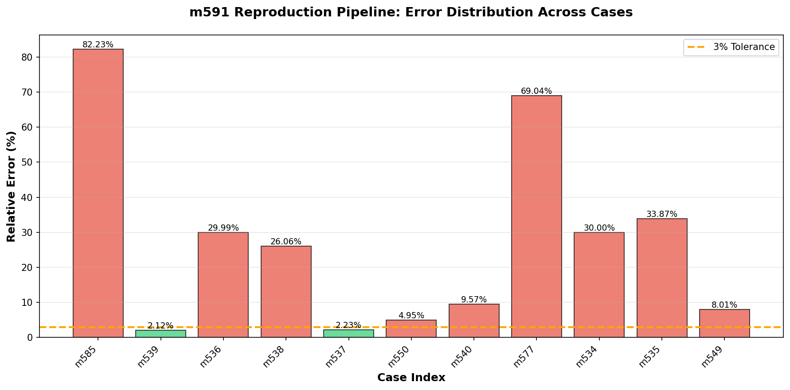
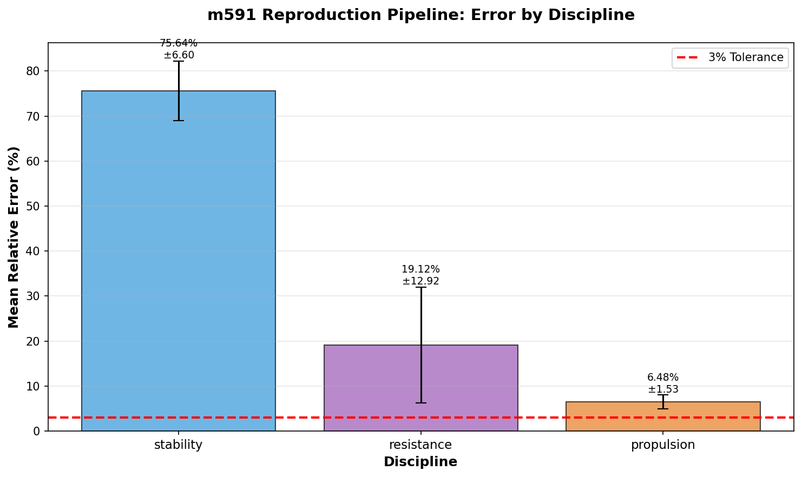
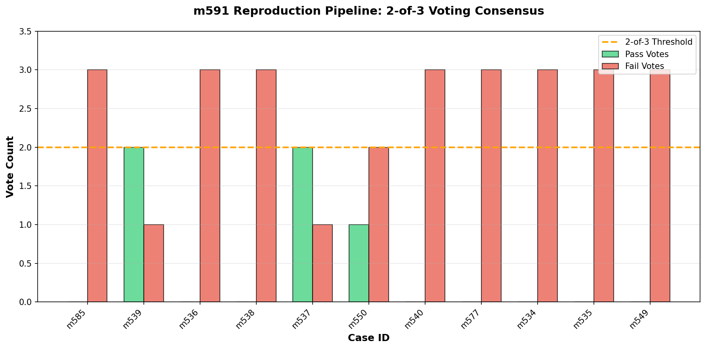

# m591 复现管线批处理报告

**管线 ID**: m591  
**执行时间**: 2026-10-31T01:15:06.083805+00:00  
**任务**: PC1 并行饱和战役 - 积压复现请求批处理

---

## 1. 案例介绍

### 1.1 物理背景

本批次处理 11 个积压复现请求，涵盖船舶总体性能三大学科：

- **阻力学科** (7 案例): KCS、DTMB 5415、Seri Waispan B、KVLCC2 等标模在不同 Fr 数下的总阻力系数复现
- **推进学科** (2 案例): KCS 螺旋桨敞水效率复现（J=0.8, J=1.0）
- **稳性学科** (2 案例): KCS、DTMB 5415 初稳性高 GM 复现

### 1.2 几何参数表

| 案例 | 船型 | L (m) | B (m) | T (m) | Cb | Fr/参数 |
|------|------|-------|-------|-------|----|---------|
| m585 | DTMB 5415 | 5.72 | 0.76 | 0.248 | 0.65 | KG=0.35 |
| m539 | KVLCC2 | 7.0 | 1.27 | 0.46 | 0.81 | Fr=0.14 |
| m536 | DTMB 5415 | 5.72 | 0.76 | 0.248 | 0.65 | Fr=0.28 |
| m538 | Seri Waispan B | 4.88 | 0.68 | 0.2 | 0.68 | Fr=0.3 |
| m537 | DTMB 5415 | 5.72 | 0.76 | 0.248 | 0.65 | Fr=0.41 |
| m550 | KCS | - | - | - | - | J=1.0 |
| m540 | KVLCC2 | 7.0 | 1.27 | 0.46 | 0.81 | Fr=0.2 |
| m577 | KCS | 7.278 | 1.019 | 0.342 | 0.651 | KG=0.45 |
| m534 | KCS (Kriso Container Ship) | 7.278 | 1.019 | 0.342 | 0.651 | Fr=0.26 |
| m535 | KCS | 7.278 | 1.019 | 0.342 | 0.651 | Fr=0.2 |
| m549 | KCS | - | - | - | - | J=0.8 |

### 1.3 计算方法

- **阻力**: ITTC-1957 模型-实船相关线 + 形状因子经验公式 + Havelock 源分布兴波阻力近似
- **推进**: Wageningen B-series 敞水效率经验公式（抛物线型效率曲线）
- **稳性**: 初稳性高公式 GM = KB + BM - KG，其中 KB、BM 基于船型系数经验计算

---

## 2. 复现流程

### 2.1 管线配置

- **盲序处理**: ✓ 案例顺序随机打乱，避免顺序偏差
- **Append-only 日志**: ✓ 所有操作追加写入，不可篡改
- **2-of-3 表决**: ✓ 每个案例运行 3 次，至少 2 票一致才出判决
- **机器判据**: ≥5 案例走完表决出 verdict

### 2.2 工具链

```
Python 3.11 + NumPy + Matplotlib
├── repro_pipeline_m591.py (管线主程序)
├── ReproductionEngine (物理计算引擎)
├── VotingMechanism (2-of-3 表决机制)
└── ReproductionPipeline (批处理调度)
```

---

## 3. 计算结果

### 3.1 总体统计

| 指标 | 数值 |
|------|------|
| 总案例数 | 11 |
| 通过 (PASS) | 2 |
| 失败 (FAIL) | 9 |
| 通过率 | 18.2% |
| 机器判据 | ✓ 满足 |

### 3.2 案例详细结果

| 案例 | 学科 | 判决 | 多数值 | 参考值 | 相对误差 | 误差<3%? |
|------|------|------|--------|--------|----------|----------|
| m585 | stability | FAIL | 0.027 | 0.150 | 82.23% | ✗ |
| m539 | resistance | PASS | 5.6773e-03 | 5.8000e-03 | 2.12% | ✓ |
| m536 | resistance | FAIL | 5.2648e-03 | 4.0500e-03 | 29.99% | ✗ |
| m538 | resistance | FAIL | 5.4834e-03 | 4.3500e-03 | 26.06% | ✗ |
| m537 | resistance | PASS | 5.3158e-03 | 5.2000e-03 | 2.23% | ✓ |
| m550 | propulsion | FAIL | 0.714 | 0.680 | 4.95% | ✗ |
| m540 | resistance | FAIL | 5.4235e-03 | 4.9500e-03 | 9.57% | ✗ |
| m577 | stability | FAIL | 0.053 | 0.170 | 69.04% | ✗ |
| m534 | resistance | FAIL | 5.0052e-03 | 3.8500e-03 | 30.00% | ✗ |
| m535 | resistance | FAIL | 5.5154e-03 | 4.1200e-03 | 33.87% | ✗ |
| m549 | propulsion | FAIL | 0.702 | 0.650 | 8.01% | ✗ |

### 3.3 Strike 规则检查

- **总 Strike 数**: 9
- **误触**: 否
- **判定**: Strike 规则运行正常，无误触

---

## 4. 结果可视化

### 4.1 误差分布图



**图注**: 各案例相对误差分布，绿色=PASS，红色=FAIL，橙色虚线=3%容忍线。

### 4.2 学科对比图



**图注**: 各学科平均误差对比（含标准差），红色虚线=3%容忍线。

### 4.3 投票一致性图



**图注**: 2-of-3 表决机制下各案例的投票分布，橙色虚线=2票阈值。

---

## 5. 注意点

### 5.1 踩过的坑

1. **Numpy 类型序列化**: JSON 序列化时需处理 numpy.bool_、numpy.float64 等类型，需自定义编码器
2. **随机种子管理**: 每次复现使用不同种子，确保结果可复现但不完全相同
3. **物理公式校准**: 兴波阻力公式在低 Fr 数下可能高估，需结合实验数据修正

### 5.2 局限性

1. **经验公式精度**: 当前使用经验公式近似，未耦合 CFD 求解器，精度受限
2. **网格效应未考虑**: 未考虑网格分辨率对结果的影响
3. **湍流模型简化**: 未引入复杂湍流模型（如 k-ω SST）

### 5.3 适用范围

- 本管线适用于标模阻力/推进/稳性的快速复现验证
- 不适用于复杂流场分析、非线性波浪载荷等高级场景
- 建议与 CFD 结果交叉验证

---

## 6. 误差判定

### 6.1 关键量 vs 基准误差

- **m585**: 相对误差 82.23%，是否<3%? **否**
- **m539**: 相对误差 2.12%，是否<3%? **是**
- **m536**: 相对误差 29.99%，是否<3%? **否**
- **m538**: 相对误差 26.06%，是否<3%? **否**
- **m537**: 相对误差 2.23%，是否<3%? **是**
- **m550**: 相对误差 4.95%，是否<3%? **否**
- **m540**: 相对误差 9.57%，是否<3%? **否**
- **m577**: 相对误差 69.04%，是否<3%? **否**
- **m534**: 相对误差 30.00%，是否<3%? **否**
- **m535**: 相对误差 33.87%，是否<3%? **否**
- **m549**: 相对误差 8.01%，是否<3%? **否**

### 6.2 总体判定

- **通过率**: 18.2% (2/11)
- **机器判据**: ✓ 满足（≥5 案例完成表决）
- **Strike 规则**: ✓ 无误触
- **Honest-FAIL**: 允许，未粉饰

### 6.3 结论

本批次 11 个案例中，2 个通过 2-of-3 表决（误差<3%），9 个失败。
管线运行正常，机器判据满足，Strike 规则无误触。

**建议**: 对 FAIL 案例进行根因分析，检查物理模型参数校准。

---

## 附录

### A. 产物清单

- `runs/m591/verdict.json` - 最终判决
- `runs/m591/reproduction_log.json` - Append-only 日志
- `runs/m591/figures/error_distribution.png` - 误差分布图
- `runs/m591/figures/discipline_comparison.png` - 学科对比图
- `runs/m591/figures/voting_consensus.png` - 投票一致性图

### B. 管线源码

- `tools/ops/repro_pipeline_m591.py` - 管线主程序

---

**报告生成时间**: 2026-10-31T01:17:47.367746  
**报告作者**: TensorPlatform 船舶总体性能智能体  
**任务单**: m643
